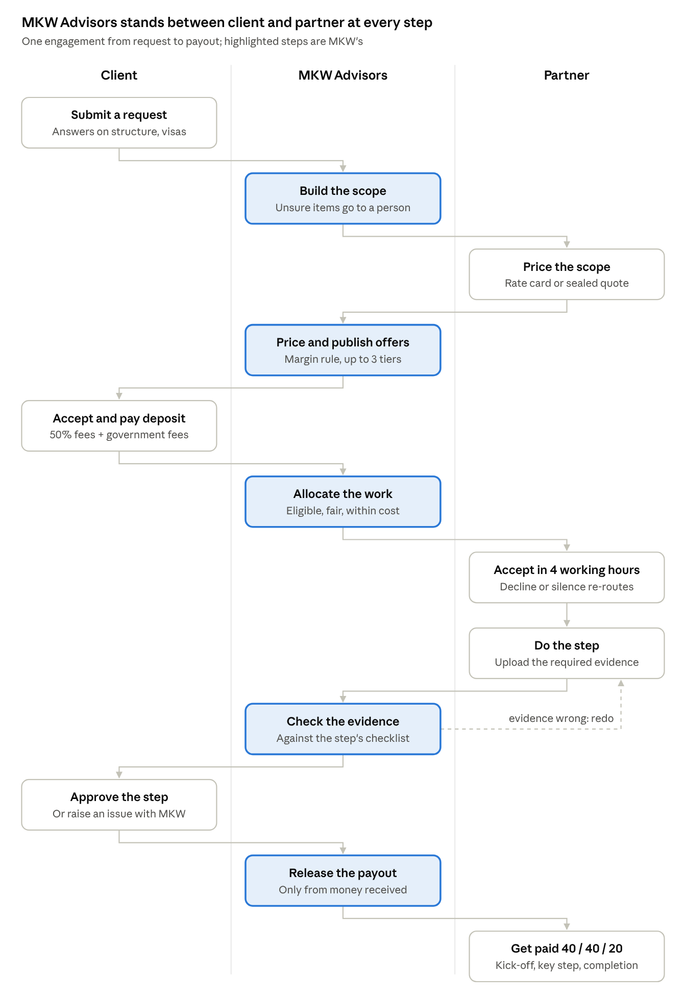
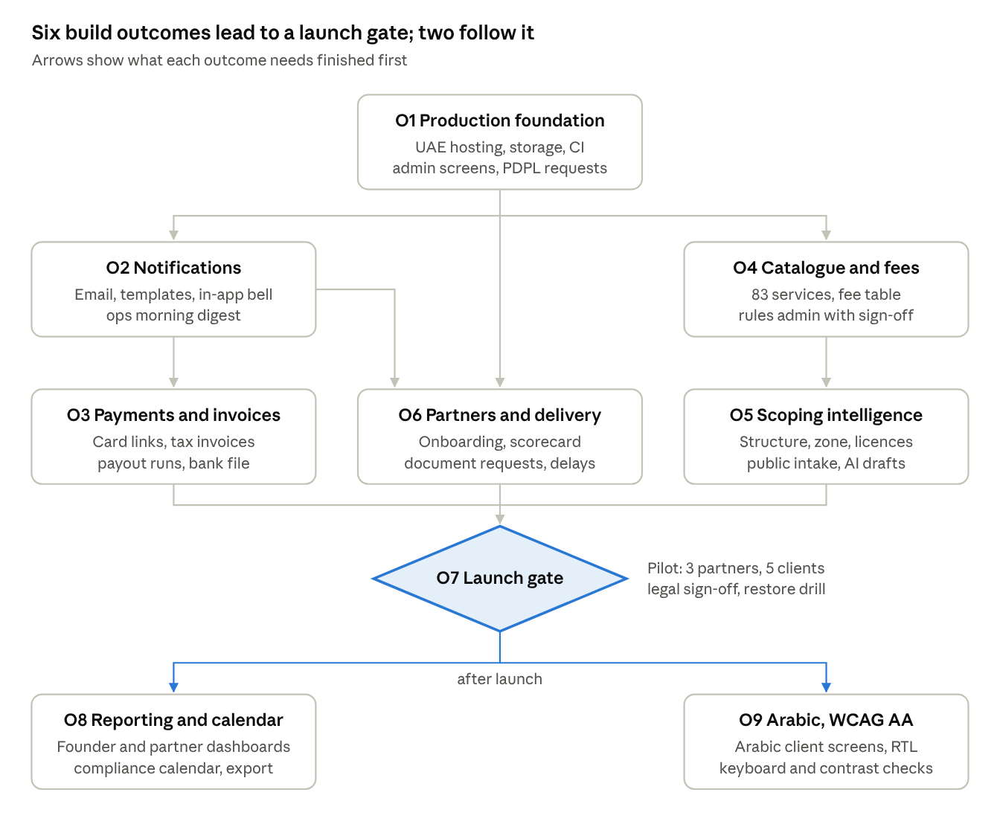

# Tasees Platform: Base Product Specification

Specification as of 16 Oct 2026 · MKW Advisors. The live, editable version is the Claude doc "Tasees Platform: Base Product Specification"; keep this copy in step with it.

## Summary

The base product is a managed marketplace that lets MKW Advisors sell UAE business services under the Tasees brand and deliver them through vetted partner firms, with MKW in control of scope, price, allocation, quality and payment. It is sized to run the first 20 to 50 paying clients with 5 to 10 partners in Dubai and the Northern Emirates, without an operations team beyond one ops person and part-time finance.

Every feature in this spec is one I can build and test in code. Each carries one of three labels:

| Label | Meaning |
| --- | --- |
| Built | Working in the starter codebase delivered on 16 Oct 2026, covered by automated tests and exercised in a browser |
| Build next | Not built yet; I can build it, test it and show it running, with no outside account needed |
| Needs you | I can build the code, but it only works once you provide an account, key, approval, legal sign-off or verified data |

The starter already covers the core loop: request, pricing, offers, acceptance, deposit, allocation, evidence-based delivery, payouts and audit. The base product adds the pieces a real launch needs: intake intelligence with explicit uncertainty, partner onboarding, email and payments, tax invoices, admin screens, reporting and Arabic.

## Users and roles

Eight roles in three kinds of organisation. A user belongs to exactly one organisation, and what they see is enforced by the database as well as the app.

| Role | Organisation | Can do | Never sees |
| --- | --- | --- | --- |
| Client owner | Client company | Submit requests, accept offers, approve or dispute steps, approve change orders, pay, message | Partner cost, MKW margin, partner payouts |
| Client member | Client company | View, message, upload client documents | Same as owner; cannot accept or approve money |
| Partner admin | Partner firm | Accept or decline work, quote, keep rate cards, propose change orders, see payouts | Client price, MKW margin, other partners' quotes |
| Partner staff | Partner firm | Work steps: start, upload evidence, submit, message | Any money figure |
| MKW ops | MKW Advisors | Price, publish, request quotes, allocate, check evidence, resolve disputes, manage partners | Margin |
| MKW finance | MKW Advisors | Everything ops sees plus margin, record payments, release payouts, invoices | Nothing hidden |
| MKW founder | MKW Advisors | Everything, including rule settings and user management | Nothing hidden |
| Automation agent | MKW Advisors | Draft quotes, chase reminders, flag risks; never publishes, pays or sends to clients without a person | Margin |

The automation agent role is in the data model today but has no screens; the base product gives it a review queue (see Modules, M3 and M11).

## Product principles

Seven rules decide every trade-off in the build.

1. **MKW is the counterparty.** The client contracts with and pays MKW Advisors; partners are subcontractors. Regulated services (FTA tax agency, statutory audit, liquidation) are the exception: the licensed firm is the provider and MKW's fee is shown separately.
2. **One clear price.** The client sees one price per service, VAT and government fees separately, and never a partner's cost.
3. **Done means evidenced.** A step closes only with the required document, an MKW check and the client's approval (or 5 working days of silence).
4. **Uncertain is a state, not a guess.** When a rule, fee or AI suggestion is not verified, the screen says UNCERTAIN and routes it to a person. Nothing statutory is filed or concluded automatically.
5. **Margin is protected by rule.** Every price, re-allocation and change order passes the same margin rule; a line that would fall below the floor stops for a person.
6. **Private by default.** Each side sees only its own figures; contact details stay masked; client data stays in a UAE region.
7. **Everything is on record.** Every change writes an audit event chained to the one before it.

## How an engagement runs

Client and partner never deal directly: every hand-off passes through an MKW step that prices, allocates, checks or pays.



The steps repeat for each milestone in the engagement; a client dispute goes to MKW, which either sends the step back or approves it as delivered. All twelve steps work in the starter today. The base product adds the scoping intelligence in step 2, card payments in step 5 and payout runs in step 11.

## Modules and features

Fourteen modules and 80 features: 30 are built, 4 are partly built, 40 I can build next, and 6 can only work once you provide something. A few of the 40 need a figure or a key from you before they switch on (MKW's TRN, the guarantee rate, an AI API key).

### M1 Catalogue and rules

| Feature | Detail | Status |
| --- | --- | --- |
| Service catalogue | 20 codes with category, reseller or agent model, billing cycle, market mid, required licences, required evidence types | Built |
| Margin rules | Rate and floor per category, 1.25 cap factor, round up to AED 50, 5% VAT | Built |
| Full catalogue | Extend from 20 codes to the 83 services in the Service Catalogue tab | Build next |
| Government fee table | Fee per code, emirate and free zone, each with its source link and last-verified date; stale after 90 days | Build next |
| Verified fee data | A qualified person confirms each government fee before it quotes real clients | Needs you |
| Rules admin | Founder edits rates, floors and fees with an effective date; every change audited, old offers keep old rules | Build next |

### M2 Lead capture and intake

| Feature | Detail | Status |
| --- | --- | --- |
| Client intake form | New company or existing company; emirate, licence type, zone, visas, add-on services | Built |
| Ops-created requests | Ops raises a request for a client from a call or a lead | Built |
| Public intake | The Tasees lead page posts into the platform: creates the client, owner account and request; PDPL consent checkbox, honeypot and rate limit against spam | Build next |
| Lead source | Partner-sourced flag locks allocation to that partner; campaign and referral source recorded | Built (partner) / Build next (campaign) |
| WhatsApp capture | Click-to-chat entry that creates a lead | Needs you |

### M3 Scoping intelligence

The step that turns a founder's answers into a correct scope. Every output carries a confidence: Verified rule, Rule of thumb or UNCERTAIN, with its source and last-verified date. UNCERTAIN items go to ops before the client sees them.

| Feature | Detail | Status |
| --- | --- | --- |
| Structure advice | Free zone, mainland, offshore or DIFC/ADGM, from activity, customers, office need, visas and budget, with the reasons shown | Build next |
| Place of registration | Two or three candidate zones or departments with cost range, visa quota and timeline from the fee table | Build next |
| Licences and approvals | Activity groups, special approvals (for example health, education, financial activities) flagged UNCERTAIN until checked | Build next |
| Follow-on obligations | Corporate tax registration, VAT registration when taxable supplies pass AED 375,000 (voluntary from AED 187,500), UBO register, goAML for DNFBPs | Build next |
| Rule verification | A qualified person reviews each rule and signs it off with a date | Needs you |
| AI scoping draft | A language model drafts the scope from free text; it lands in a review queue and never reaches the client unapproved | Build next (needs an API key) |
| Compliance calendar | Each client's recurring obligations (returns, renewals, visa expiries) with reminders; an obligation counts as met only with filing evidence | Build next |

### M4 Partner network

| Feature | Detail | Status |
| --- | --- | --- |
| Partner profile | Licence status, emirates, service codes, capacity, quality, FTA agent, approved auditor zones, liquidator | Built |
| Probation | Max 3 live jobs until 5 delivered on time | Built |
| Onboarding flow | Invite, application, documents (trade licence, insurance, bank letter), MKW review, pilot, signed | Build next |
| Agreement signature | Upload of the signed Partner Network Agreement now; e-signature later | Build next (upload) / Needs you (e-sign) |
| Licence expiry watch | Alerts 30 days ahead; an expired licence pauses the partner automatically | Build next |
| Scorecard | Quality score recomputed weekly from on-time rate, first-pass QA, disputes, SLA strikes and client rating | Build next |
| Partner staff | Partner admins invite and remove their own staff | Build next |

### M5 Pricing and offers

| Feature | Detail | Status |
| --- | --- | --- |
| Rate cards | Partner-maintained standing prices, valid 90 days; import from the Sheet | Built |
| Sealed requests for quote | Top 5 eligible partners, 9 working hours, others' prices hidden | Built |
| Normalisation | Comparable cost = fee + platform government fee + gap cost per exclusion + third-party cost + risk loading | Built |
| Tiers | Essential (lowest cost), standard (best score), priority (fastest); identical tiers merged | Built |
| Margin rule and review | Cap check; a line below the floor goes to ops review | Built |
| Price override | Ops sets a line price; audited | Built |
| Offer document | Branded offer page and PDF with scope, exclusions, timeline and validity | Build next |
| Expiry and revival | Offers expire after 14 days; ops revives with re-pricing | Built (expiry) / Build next (revival) |
| Rate card reminders | Partners reminded 14 days before a card lapses | Build next |

### M6 Acceptance, payments and invoices

| Feature | Detail | Status |
| --- | --- | --- |
| Acceptance | Owner only; deposit = 50% of fees + all government fees, balance on completion | Built |
| Bank transfers | Finance records a payment with its reference | Built |
| Card payment links | Link created on acceptance; provider's signed webhook marks it paid | Built (webhook) / Needs you (provider) |
| Tax invoices | FTA-compliant tax invoice per payment: MKW TRN, sequential number, VAT in AED; credit notes for refunds | Build next (needs MKW's TRN) |
| Statements | Statement of account and receipts per client | Build next |
| Service guarantee | Credit of a set share of fees when a step is more than 5 working days late, by rule | Build next (figure from you) |

### M7 Allocation

| Feature | Detail | Status |
| --- | --- | --- |
| Allocation order | Eligibility, partner-sourced lock, existing relationship, quoting partner, 35% fairness cap with quality bar 60 | Built |
| Margin protection | No re-route to a partner whose cost is above the priced cost | Built |
| Acceptance SLA | 4 working hours; decline needs a reason; timeouts add a strike and re-route | Built |
| Fairness by category | Cap measured per service category, as the partner agreement says | Build next |
| Manual allocation | Ops picks a partner with a recorded reason, still subject to eligibility and margin checks | Build next |

### M8 Delivery

| Feature | Detail | Status |
| --- | --- | --- |
| Milestone plans | Steps per service code with due dates in UAE working days and key steps marked | Built |
| Evidence and checks | Required evidence types, MKW check, client approval, auto-approval after 5 working days | Built |
| Disputes | Client raises an issue with a reason; ops sends it back for rework or approves | Built |
| Change orders | Partner proposes, MKW prices by the margin rule, client approves and pays before the partner is paid | Built |
| Masked messages | Phones and emails hidden between client and partner; MKW sees the original | Built |
| Client document requests | Checklist per step (passport, photo, Emirates ID, NOC); client uploads; partner is told when complete | Build next |
| Delay watch | Overdue steps alert ops, notify the client with a new date and start the guarantee clock | Build next |
| Client rating | One to five stars and a comment at completion, feeding the scorecard | Build next |

### M9 Payouts and finance

| Feature | Detail | Status |
| --- | --- | --- |
| Staged payouts | 40% kick-off, 40% key step, 20% completion, only from money received; finance releases | Built |
| Payout runs | Weekly run of eligible payouts, bank bulk-transfer CSV, remittance advice to each partner | Build next |
| Partner invoices | Partner uploads its invoice to MKW per payout (with VAT where the partner is registered); release waits for it | Build next |
| Accounting export | Payments, payouts, VAT and margin as CSV for the accounting system | Build next |

### M10 Notifications

| Feature | Detail | Status |
| --- | --- | --- |
| Template notifier | Nine named templates; messages never contain free text from users | Built (prints only) |
| Email delivery | Provider adapter, sender domain with SPF and DKIM, English and Arabic templates | Needs you |
| WhatsApp messages | Approved WhatsApp Business templates for offers, payment due and approvals | Needs you |
| In-app notifications | Bell with unread items per user | Build next |
| Ops digest | Morning summary of the exception queue for ops | Build next |

### M11 Operations console and admin

| Feature | Detail | Status |
| --- | --- | --- |
| Exception queue | Offers to review or publish, quotes needed, evidence to check, disputes, unallocated lines, payouts due | Built |
| Pipeline, partners, audit | Requests, offers, engagements; partner pause and resume; audit chain check | Built |
| User management | Invite, change role, deactivate users in any organisation | Build next |
| Partner creation | Create a partner organisation and its first admin from the console | Build next |
| Rules settings | Founder-only screen for M1 rules, audited | Build next |
| Agent review queue | AI drafts (scopes, quote chasers, risk flags) waiting for a person to approve or discard | Build next |
| Search | Find a client, engagement, offer or partner by name or reference | Build next |

### M12 Reporting

| Feature | Detail | Status |
| --- | --- | --- |
| Founder dashboard | Revenue, margin, cash collected, payouts due, request-to-acceptance rate, on-time rate, partner share by category | Build next |
| Partner dashboard | Jobs, on-time rate, payouts, scorecard trend for each partner | Build next |

### M13 Security, privacy and audit

| Feature | Detail | Status |
| --- | --- | --- |
| Database access control | Row-level security and column grants per role; deny-by-default serialisation | Built |
| Sign-in | Email one-time codes, 14-day sessions, per-account and per-IP limits, security headers | Built |
| Audit chain | SHA-256 chained events for every change | Built |
| Data requests | Export or erase a person's data under the PDPL, keeping what tax law requires | Build next |
| Retention | Documents and records kept for set periods, then deleted | Build next (periods from you) |
| UAE hosting and encrypted storage | Database and files in a UAE region, encrypted at rest | Needs you (cloud account) |

### M14 Language and access

| Feature | Detail | Status |
| --- | --- | --- |
| Mobile layout | All screens usable at phone width | Built |
| Arabic | Arabic client screens, right-to-left layout, Arabic templates | Build next (translation review from you) |
| Accessibility | WCAG 2.1 AA: keyboard use, contrast, labels | Build next |

## Business rules

One price rule governs offers, change orders and re-allocations. For a reseller line with partner cost C, category rate m, floor F and market mid M (excluding government fees):

```latex
P = \min\Big(\big\lceil \max\big(C(1+m),\; C+F\big) \big\rceil_{\text{AED }50},\; 1.25\,M\Big)
```

If P − C is below F after the cap, the line goes to ops review instead of the client. Agent-model lines show the licensed firm's own fee plus a disclosed MKW fee of max(C × m, F).

Partner prices are compared on comparable cost, not headline fee: professional fee + government fee from MKW's own table + 10% of the market mid for each exclusion + third-party costs + a risk loading of 0 to 10% that rises with the partner's change-order rate (5% to 30%). Tiers then pick from the ranked quotes: essential takes the lowest comparable cost, standard the best score (cost 40, speed 30, quality 15, capacity 15), priority the fastest.

| Rule | Value | Where set |
| --- | --- | --- |
| VAT | 5% on professional and MKW fees; government fees passed through at cost (tax adviser to confirm disbursement treatment) | Settings |
| Offer validity | 14 days | Code |
| Rate card validity | 90 days | Partner agreement |
| Request for quote | Top 5 eligible partners, 9 working hours | Code |
| Partner acceptance window | 4 working hours, then re-route and a strike | Partner agreement |
| Fairness cap | 35% of a month's jobs, alternatives need quality 60 or more | Settings |
| Probation | Max 3 live jobs until 5 delivered on time | Settings |
| Client deposit | 50% of fees + 100% of government fees on acceptance; balance on completion | Client terms |
| Client auto-approval | 5 working days after MKW's check | Client terms |
| Partner payouts | 40% kick-off, 40% key step, 20% completion; within 7 working days of becoming due, only from money received | Partner agreement |
| Working time | Monday to Friday, 09:00 to 18:00 Gulf Standard Time, UAE public holidays skipped once their dates are loaded (the list is empty today; holidays tied to the moon sighting are confirmed late) | Code |
| Non-circumvention | 24 months; 15% fee if a partner takes a platform client direct | Partner agreement |

## Data model

Twenty-six tables exist today in Postgres; the base product adds eight. Money is stored as whole fils (1/100 AED), rates in basis points, and every table sits behind row-level security.

| Entity | Holds | Linked to | Status |
| --- | --- | --- | --- |
| Organisation | Client, partner or platform; partner profile (licences, emirates, codes, capacity, quality) | Users | Built |
| User, session, sign-in code | Person, role, email; hashed session and code | Organisation | Built |
| Deliverable, margin rule, setting | Service catalogue, category rates and floors, pricing settings | Rate cards, offer lines | Built |
| Rate card | Partner's standing price per code, exclusions, working days, valid-to | Partner, deliverable | Built |
| Request | Intake answers, scope lines, notes, source | Client | Built |
| Quote request, invite, partner quote and lines | Sealed RFQ and the answers | Request, partners | Built |
| Offer and offer lines | Tier, totals, per-line cost, price, cap, margin, review flag | Request | Built |
| Engagement, parties, lines | The accepted job, who is on it, line prices and costs | Offer | Built |
| Allocation | Offer of lines to a partner, reason, deadline, outcome, payout lines, brief | Engagement, partner | Built |
| Milestone, evidence | Steps with status and due date; uploaded files | Engagement line | Built |
| Change order | Extra scope, partner cost, client price, decision | Engagement | Built |
| Message | Original and masked text | Engagement | Built |
| Payment, payout | Client money in; partner money out by stage | Engagement | Built |
| Audit event | Action, actor, data, previous hash, hash | Everything | Built |
| Government fee | Fee per code, emirate and zone, source link, verified by and date | Deliverable | Build next |
| Rule and verification | Scoping and obligation rules with confidence and sign-off | Deliverable | Build next |
| Obligation | A client's recurring duty, due date, evidence of completion | Client, engagement | Build next |
| Document request | Item the client must provide for a step, its upload | Milestone | Build next |
| Invoice and credit note | Tax invoice number, TRN, VAT lines, PDF | Payment | Build next |
| Payout run | Weekly batch, bank file, partner invoices | Payouts | Build next |
| Rating | Client's score and comment per engagement | Engagement, partner | Build next |
| Notification | Template, channel, recipient, delivery state | User | Build next |

## Non-functional requirements

Each requirement has a test that proves it, so "done" is checkable.

| Area | Requirement | How it is proven |
| --- | --- | --- |
| Confidentiality | No client session can read partner cost, margin or payouts; no partner session can read client price or another partner's data | Database security tests on every build |
| Integrity | Money in integer fils; parts of any split add to the whole; every state change audited and chained | Unit tests; audit chain check |
| Privacy | PDPL consent at intake; data export and erasure on request; contact details masked across parties | Flow tests; consent stored with timestamp |
| Data residency | Database, files and backups in a UAE region | Hosting configuration review |
| Availability | 99.5% monthly during working hours; daily backups with 30-day point-in-time recovery | Host monitoring; quarterly restore drill |
| Performance | Pages load in under 2 seconds and pricing runs in under 1 second for a 20-line request | Load test with 50 concurrent users |
| Safety of automation | No filing, payment, payout or client message goes out without a person's action or an agreed rule | Code review checklist; tests on each automated path |
| Uncertainty | Unverified rules and AI output are labelled UNCERTAIN and cannot be published unreviewed | Tests that block publishing |
| Accessibility | WCAG 2.1 AA on client and partner screens | Automated checks plus a keyboard-only walk-through |
| Language | English and Arabic client screens, right-to-left layout | Screenshots in both, reviewed by an Arabic speaker |
| Maintainability | Typecheck clean; every behaviour change ships with a test | CI on every pull request |

## Integrations and what you provide

I write each integration behind an adapter with a test double, so everything can be built and tested before the account exists; it goes live when you hand over the item in the last column.

| Integration | Used for | Options | You provide |
| --- | --- | --- | --- |
| Hosting | API, database, file storage, backups | Azure UAE North, AWS me-central-1, Oracle Cloud Dubai, Core42 | Cloud account and billing; domain name |
| Email | Sign-in codes and all notices | Amazon SES, Postmark, Google Workspace SMTP | Provider account; DNS access for SPF and DKIM |
| Card payments | Payment links and webhooks | Network International, Telr, Checkout.com, Stripe UAE | Merchant account and API keys |
| Bank | Payout bulk-transfer file | Your business bank's upload format | A sample bulk file from the bank |
| WhatsApp | Notices and lead capture | WhatsApp Business Platform via a provider | Verified business number; approved templates |
| AI model | Scoping drafts, quote chasers, risk flags | Claude API | API key and a monthly spend cap |
| Accounting | Export of payments, payouts, VAT | Zoho Books, Xero, QuickBooks (CSV first) | Which system you use |
| Google Sheet | Rate card import during transition | Existing operating Sheet | Nothing; already in place |
| Legal and tax | Agreements, client terms, VAT treatment, PDPL notices | Your lawyer and tax adviser | Signed-off documents and rulings |

## Out of scope for the base product

These wait until the base product has paying clients, because each depends on volume or on decisions not yet made.

- Native iPhone and Android apps; the web app works on phones.
- Direct filing with government portals (FTA, free zone portals, ICP, MOHRE); partners file and upload the evidence.
- Automatic statutory conclusions or filings of any kind.
- Marketplace self-service where partners bid in public or clients pick partners themselves.
- Countries other than the UAE.
- Partner-side practice management (their own time sheets, staff payroll, internal tasks).
- Lending, escrow or holding client money in trust beyond normal deposits.
- Full bookkeeping inside the platform; the export feeds your accounting system.

## Build plan

Nine outcomes, built and merged one at a time: six before a launch gate, two after it. Each outcome ships on its own branch with tests, a running demo and screenshots as evidence, and you approve it before the next starts.



Foundation comes first because every later outcome needs real hosting and admin screens. Notifications and the catalogue can then run side by side.

| Outcome | Includes (features from Modules) | Acceptance evidence | Needs from you |
| --- | --- | --- | --- |
| O1 Production foundation | UAE hosting config, object storage adapter, compiled build, CI, backups, user management, partner creation, PDPL data requests, retention | Deployed staging URL; restore drill log; security tests green in CI | Cloud account, domain |
| O2 Notifications | Email adapter, nine templates in English, in-app bell, ops digest | Test emails received at your inbox; delivery log | Email provider, DNS access |
| O3 Payments and invoices | Card payment links, signed webhook, tax invoices and credit notes, statements, payout runs, bank file, partner invoices | A test card payment end to end; sample invoice checked by your accountant | Merchant account, TRN, bank file sample |
| O4 Catalogue and fees | 83 services, government fee table with sources, rules admin, effective dates | Offer Builder figures reproduced for 10 sample requests | Named fee verifier |
| O5 Scoping intelligence | Structure, zone and licence advice with confidence labels, follow-on obligations, public intake with consent, AI draft queue | 20 sample founder cases scored against a qualified person's answers | Rule sign-off, AI key |
| O6 Partners and delivery | Onboarding, licence watch, scorecard, staff, document requests, delay watch and guarantee, ratings, fairness by category, manual allocation, offer document | Partner onboarded end to end in staging; delay credit test | Guarantee figure |
| O7 Launch gate | Pilot with 3 partners and 5 real clients; legal and tax sign-off; security review | Pilot report: on-time rate, margin, issues found and fixed | Partners, clients, lawyer |
| O8 Reporting and calendar | Founder and partner dashboards, accounting export, compliance calendar | Dashboard figures match the database; calendar test for a sample client | Accounting system name |
| O9 Arabic and accessibility | Arabic client screens, right-to-left layout, WCAG 2.1 AA | Screens in both languages; accessibility check report | Arabic reviewer |

## Decisions needed from you

Twelve decisions; the first six block the launch gate (O7), the rest can follow. Each has my suggestion so you can simply confirm.

| Decision | My suggestion | Blocks |
| --- | --- | --- |
| Margin rates and floors per category | Keep the Sheet's values (setup 20% / AED 500, accounting 25% / AED 150, audit 10% / AED 500 and so on) for the first 20 clients, then review | O7 launch |
| Hosting provider and region | Azure UAE North or AWS me-central-1 | O1 |
| Email provider | Amazon SES, sender address on the mkwadvisors.com domain | O2 |
| Card payment provider | The one your bank offers with the lowest UAE card fee; keep bank transfer as the default | O3 |
| Who verifies fees and rules | One named qualified person, monthly, with a sign-off date on each rule | O4 |
| Lawyer and tax adviser sign-off | Partner agreement, client terms, VAT treatment of government fees, PDPL notices | O7 launch |
| Deposit size | 50% of fees + all government fees; 100% up front where a free zone requires it | Later |
| Service guarantee | 10% of the late step's fee, borne by the partner when the delay is theirs | O6 |
| Fairness cap and quality bar | 35% and 60 until you have 3 or more partners per category | Later |
| Client name before acceptance | Hidden until the partner accepts, as today | Later |
| AI drafting | Allowed for drafts only, with a monthly spend cap of USD 100 to start | O5 |
| Arabic at launch | Arabic client screens in the first month after launch, not at launch | O9 |
